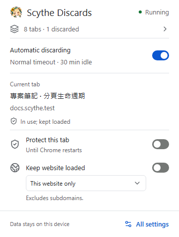
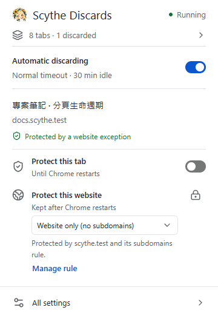
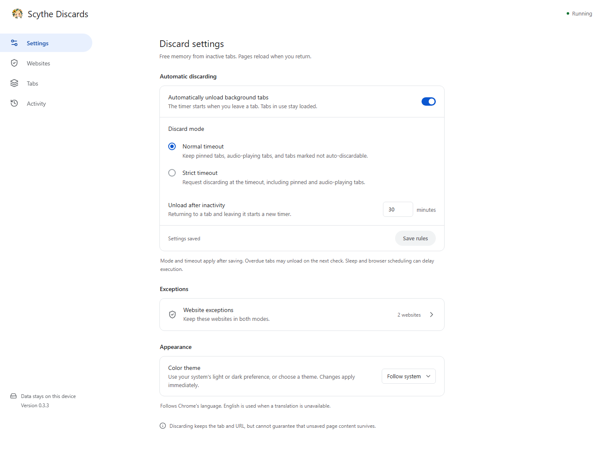

#  Scythe Discards

Automatically unload inactive Chrome pages on a timer to help free RAM. Keep your tabs and URLs; pages reload when you return.

**[Download latest](https://github.com/Lianye-Scythe/scythe-discards/releases/latest)** · [Install](#installation) · [Report a bug](https://github.com/Lianye-Scythe/scythe-discards/issues)

English · [繁體中文](docs/translations/README.zh-TW.md) · [简体中文](docs/translations/README.zh-CN.md)

[](https://github.com/Lianye-Scythe/scythe-discards/releases/latest) · [](https://github.com/Lianye-Scythe/scythe-discards/actions/workflows/ci.yml) · [MIT](LICENSE)



## Installation

1. Open the [latest release](https://github.com/Lianye-Scythe/scythe-discards/releases/latest) and download the extension ZIP, `scythe-discards-<version>.zip`. A matching `SHA256SUMS` file is provided.
2. Extract it to a permanent folder.
3. At `chrome://extensions`, enable **Developer mode**, select **Load unpacked**, and choose the extracted folder containing `manifest.json`.

GitHub's automatic **Source code** archives require a build.

<details>
<summary>Build from source</summary>

Install Node.js **24.22.1 LTS** and npm **12.2.1**, then run:

```bash
git clone https://github.com/Lianye-Scythe/scythe-discards.git
cd scythe-discards
npm ci
npm run build
```

Load the repository's `dist/` folder at `chrome://extensions` using the same **Load unpacked** action.

</details>

Defaults: **Normal mode · 30 minutes · System theme**. Returning to an unloaded page reloads it; unsaved work may be lost. Protect important websites with exceptions.

## Features

- **Timed unloading:** normal and strict modes with configurable inactivity timeouts.
- **Precise exceptions:** protect one website or a domain including its subdomains.
- **Quick controls:** pause automation, protect a tab, add or remove website rules, and undo removals.
- **Clear state:** see protection sources, timeouts, recent activity and connection errors.
- **Local history:** at most 200 session events, displayed 50 per page, with a clear action.
- **Three languages and two themes:** English, Traditional Chinese and Simplified Chinese follow Chrome's language; appearance follows the system or your light/dark choice.

## More screenshots

<details>
<summary>Website rule sources and the settings page</summary>





</details>

Screenshots use an isolated Windows test profile and example websites. Webpage titles retain their original language.

## How protection works

| Mode | Behavior at the timeout |
| --- | --- |
| Normal | Keeps pinned tabs, tabs playing audio, and tabs Chrome marks as not auto-discardable |
| Strict | Requests unloading even for those tabs |

**Both modes preserve active tabs, active split-view peers, website exceptions and manual tab protection.** The timer starts when you leave a tab; returning and leaving starts a new timer. Sleep, browser scheduling and rejected API calls can delay unloading.

An exact `docs.example.com` website rule does not protect `mail.example.com`; an `example.com` rule including subdomains protects both.

No fixed RAM ceiling or second-exact execution is promised. Memory benefit depends on your workload; see [validation and limits](docs/VALIDATION.md).

## Updating

Keep the existing installation folder path, replace its built contents and click **Reload** at `chrome://extensions`. Keeping the path preserves the unpacked extension ID and stored settings; an older `chrome-discards` folder name can stay.

Reload/update resets inactivity timers, manual tab protection and recent activity. Mode, timeout, website exceptions and theme persist.

## Privacy and permissions

All runtime code and assets are bundled locally. There are no accounts, telemetry, content scripts or remote backend.

| Permission | Purpose |
| --- | --- |
| `tabs` | Read tab metadata and states; request unloading |
| `storage` | Save settings and bounded session state locally |
| `alarms` | Check timeouts without one persistent timer per tab |

The extension uses URLs and tab metadata locally. Read the [privacy policy](PRIVACY.md) for storage and retention details.

## Development and documentation

Chrome Manifest V3 · TypeScript · React · Radix UI · Tailwind CSS. The background worker does not load React; dependencies are exact-pinned.

- [Contributing and test commands](CONTRIBUTING.md)
- [Documentation index and repository layout](docs/README.md)
- [Validation results and limitations](docs/VALIDATION.md) · [Changelog](CHANGELOG.md)
- [Release process](docs/PUBLISHING.md) · [Translation maintenance](docs/I18N.md)
- [Technical plan](docs/PLAN.md) · [Design notes](DESIGN.md) (Traditional Chinese)

[MIT licensed](LICENSE). Bundled dependencies retain their [third-party notices](THIRD_PARTY_NOTICES.md).
