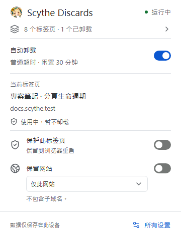
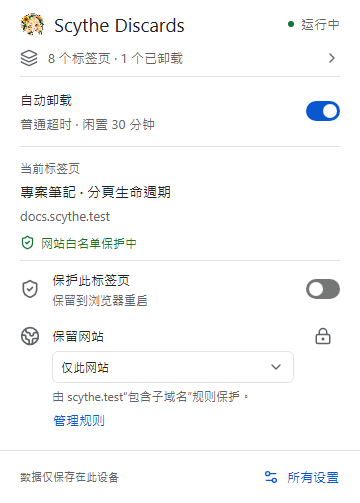
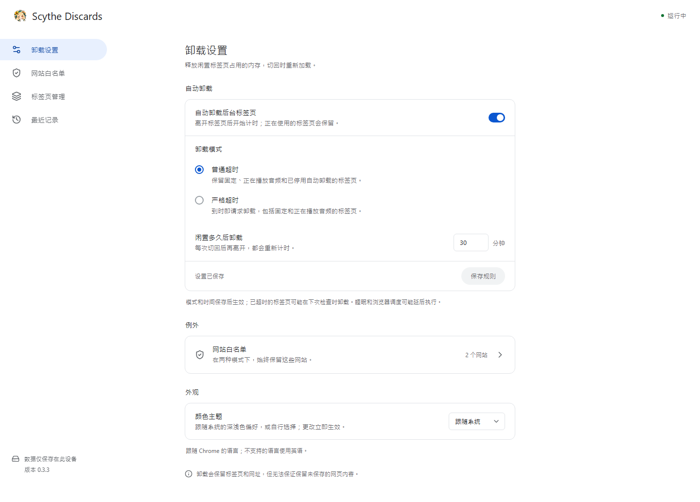

# Scythe Discards

[English](README.md) · [繁體中文](README.zh-TW.md) · 简体中文

[](https://github.com/Lianye-Scythe/scythe-discards/actions/workflows/ci.yml) · [MIT 授权](LICENSE)

在设定的闲置时间后，自动卸载 Chrome 后台网页。保留标签页和网址，切回时重新加载。

[安装方式](#安装方式) · [界面预览](#界面预览) · [Releases](https://github.com/Lianye-Scythe/scythe-discards/releases) · [问题反馈](https://github.com/Lianye-Scythe/scythe-discards/issues)

## 安装方式

**源代码已公开，v0.3.3 安装包目前仍为 Release 草稿。** 公开安装包前，可自行构建：

1. 安装 Node.js **24.22.1 LTS** 和 npm **12.2.1**，再执行：

   ```bash
   git clone https://github.com/Lianye-Scythe/scythe-discards.git
   cd scythe-discards
   npm ci
   npm run build
   ```

2. 打开 `chrome://extensions`，开启“开发者模式”。
3. 选择“加载已解压的扩展程序”，指定项目的 `dist/` 目录。

公开安装包后，可从 [Releases](https://github.com/Lianye-Scythe/scythe-discards/releases) 下载扩展 ZIP 和对应的 `SHA256SUMS`。GitHub 自动生成的 **Source code** 压缩包仍需先构建。

默认：**普通模式 · 30 分钟 · 跟随系统外观**。切回已卸载网页时会重新加载，未保存的内容可能丢失；重要网站可加入例外。

## 功能

- **闲置卸载：** 可设置超时时间，提供普通和严格模式。
- **精确网站例外：** 保护单一 hostname，或主域名及其子域名。
- **快捷操作：** 暂停自动卸载、保护标签页、增删网站规则，以及撤销移除。
- **清晰状态：** 显示保护来源、倒计时、近期记录和连接错误。
- **有限记录：** 保留本次会话最新 200 条，每页 50 条，可清除。
- **三语和深浅色：** 英语、繁体中文、简体中文跟随 Chrome 语言；外观可跟随系统或手动选择。

## 界面预览



<details>
<summary>网站规则来源和设置页</summary>





</details>

截图使用独立的 Windows 测试配置和示例网站，网页标题保留原文。

## 保护规则

| 模式 | 超时后的行为 |
| --- | --- |
| 普通 | 保留固定、播放音频和 Chrome 标记为不可自动卸载的标签页 |
| 严格 | 时间到仍会对上述标签页请求卸载 |

**两种模式均保护正在使用的标签页、同组可见分屏、网站例外和手动保护。** 离开标签页后开始计时，切回再离开会重新计时。睡眠、浏览器调度和 API 拒绝可能延迟卸载。

网站规则按 hostname 匹配，覆盖相同主机的不同路径、协议和端口。例如精确 `docs.example.com` 规则不覆盖 `mail.example.com`；包含子域名的 `example.com` 规则则覆盖两者。主域名通过本地 Public Suffix List 识别，包含私有后缀。

不保证固定 RAM 上限或精确到秒执行；内存效果取决于实际使用场景，参阅[验证结果与限制](docs/VALIDATION.md)。

## 更新

保持原安装目录路径，覆盖构建后的内容，再到 `chrome://extensions` 点击“重新加载”。原路径可保留未打包扩展的 ID 和设置；旧目录名 `chrome-discards` 可以保留。

重新加载／更新会重置计时、手动标签页保护和最近记录；模式、超时时间、网站例外和主题保留。

## 隐私与权限

运行代码和素材均随扩展打包，无账户、遥测、内容脚本或远程后端。

| 权限 | 用途 |
| --- | --- |
| `tabs` | 读取标签页信息和状态，请求卸载 |
| `storage` | 在本机保存设置和有限的会话状态 |
| `alarms` | 检查超时，无需为每个标签页维持常驻计时器 |

扩展会在本机使用网址和标签页信息；存储和保留方式参阅[隐私政策](PRIVACY.md)。

## 开发与文档

Chrome Manifest V3 · TypeScript · React · Radix UI · Tailwind CSS。后台服务不加载 React，依赖锁定精确版本。

- [参与开发和测试命令](CONTRIBUTING.md)
- [验证结果与限制](docs/VALIDATION.md) · [更新记录](CHANGELOG.md)
- [发布流程](docs/PUBLISHING.md) · [翻译维护](docs/I18N.md)
- [技术规划](docs/PLAN.md) · [设计笔记](DESIGN.md)（繁体中文）

采用 [MIT 授权](LICENSE)，第三方组件保留各自的[授权声明](THIRD_PARTY_NOTICES.md)。
