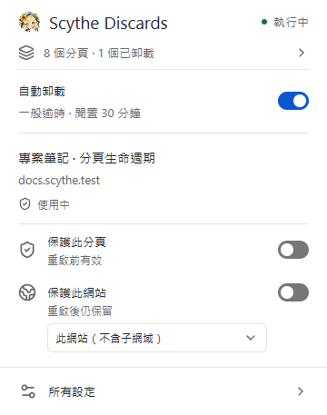
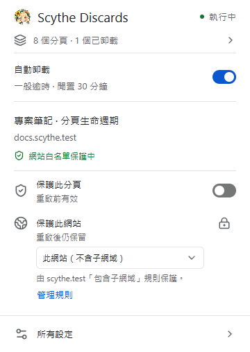
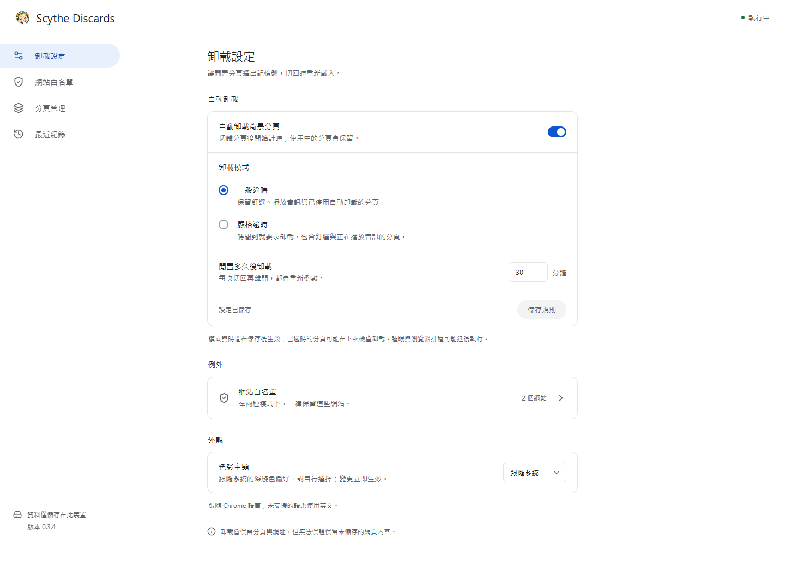

# Scythe Discards

[English](../../README.md) · 繁體中文 · [简体中文](README.zh-CN.md)

[](https://github.com/Lianye-Scythe/scythe-discards/actions/workflows/ci.yml) · [MIT 授權](../../LICENSE)

在設定的閒置時間後，自動卸載 Chrome 背景網頁。保留分頁標籤與網址，切回時重新載入。

適合習慣開啟大量分頁，並希望自行控制卸載時間與網站例外的使用者。

**[下載最新版](https://github.com/Lianye-Scythe/scythe-discards/releases/latest)** · [安裝方式](#安裝方式) · [更多畫面](#更多畫面) · [問題回報](https://github.com/Lianye-Scythe/scythe-discards/issues)



## 安裝方式

1. 開啟[最新版本](https://github.com/Lianye-Scythe/scythe-discards/releases/latest)，下載擴充功能 ZIP：`scythe-discards-<版本>.zip`，同頁提供對應的 `SHA256SUMS`。
2. 解壓縮至固定資料夾。
3. 到 `chrome://extensions` 啟用「開發人員模式」，選擇「載入未封裝項目」，指定含 `manifest.json` 的解壓縮資料夾。

GitHub 自動產生的 **Source code** 壓縮檔仍需建置。

<details>
<summary>從原始碼建置</summary>

安裝 Node.js **24.22.1 LTS** 與 npm **12.2.1**，再執行：

```bash
git clone https://github.com/Lianye-Scythe/scythe-discards.git
cd scythe-discards
npm ci
npm run build
```

在 `chrome://extensions` 使用相同的「載入未封裝項目」動作，指定專案的 `dist/` 資料夾。

</details>

預設：**一般模式 · 30 分鐘 · 跟隨系統外觀**。切回已卸載網頁時會重新載入，未儲存的內容可能遺失；重要網站可加入例外。

## 功能

- **閒置卸載：** 可設定逾時時間，提供一般與嚴格模式。
- **精確網站例外：** 保護單一網站，或主網域及其子網域。
- **快捷操作：** 暫停自動卸載、保護分頁、增刪網站規則，以及撤銷移除。
- **清楚狀態：** 顯示保護來源、倒數、近期紀錄與連線錯誤。
- **有限紀錄：** 保留本次工作階段最新 200 筆，每頁 50 筆，可清除。
- **三語與深淺色：** 英文、繁體中文、簡體中文跟隨 Chrome 語言；外觀可跟隨系統，亦可手動選擇。

## 更多畫面

<details>
<summary>網站規則來源與設定頁</summary>





</details>

畫面使用獨立的 Windows 測試設定檔與範例網站，網頁標題保留原文。

## 保護規則

| 模式 | 逾時時的行為 |
| --- | --- |
| 一般 | 保留釘選、播放音訊及 Chrome 標記為不可自動卸載的分頁 |
| 嚴格 | 時間到仍會對上述分頁提出卸載請求 |

**兩種模式都保留使用中的分頁、同組可見的分割畫面、網站例外及手動保護。** 離開分頁後開始倒數，切回再離開會重新計時。睡眠、瀏覽器排程及 API 拒絕可能延遲卸載。

僅保護 `docs.example.com` 的規則不涵蓋 `mail.example.com`；將 `example.com` 設為包含子網域，則會保護兩者。

不保證固定 RAM 上限或精確到秒執行；記憶體效益取決於實際使用情境，詳見[驗證結果與限制](../VALIDATION.md)。

## 更新

保留原安裝資料夾路徑，覆蓋建置後的內容，再到 `chrome://extensions` 按「重新載入」。原路徑可沿用未封裝擴充功能的 ID 與設定；舊資料夾名稱 `chrome-discards` 可維持。

重新載入／更新會重設倒數、手動分頁保護與最近紀錄；模式、時間、網站例外與外觀設定保留。

## 隱私與權限

執行程式與素材均隨擴充功能封裝，沒有帳號、遙測、內容注入程式或遠端後端。

| 權限 | 用途 |
| --- | --- |
| `tabs` | 讀取分頁資訊與狀態，提出卸載請求 |
| `storage` | 在本機儲存設定與有限的工作階段狀態 |
| `alarms` | 檢查逾時，不為每個分頁維持常駐計時器 |

擴充功能會在本機使用網址與分頁資訊；儲存及保留方式詳見[隱私權政策](../../PRIVACY.md)。

## 開發與文件

Chrome Manifest V3 · TypeScript · React · Radix UI · Tailwind CSS。背景服務不載入 React，依賴固定精確版本。

- [參與開發與測試指令](../../CONTRIBUTING.md)
- [文件索引與專案結構](../README.md)
- [驗證結果與限制](../VALIDATION.md) · [版本紀錄](../../CHANGELOG.md)
- [發佈流程](../PUBLISHING.md) · [翻譯維護](../I18N.md)
- [技術規劃](../PLAN.md) · [設計筆記](../../DESIGN.md)

採用 [MIT 授權](../../LICENSE)，第三方元件保留各自的[授權聲明](../../THIRD_PARTY_NOTICES.md)。
